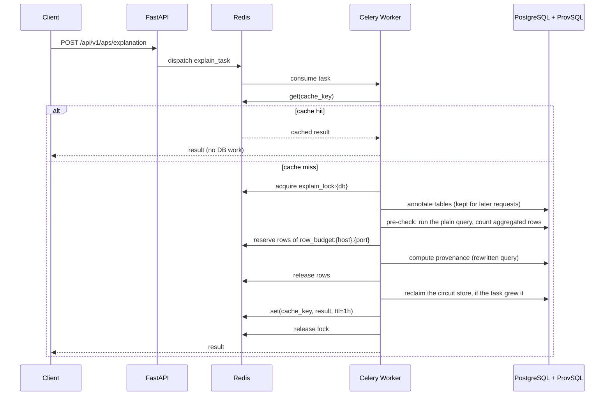

# Service Architecture

The AP Explanation service is a RESTful API designed to annotate SQL queries and explain data provenance using PostgreSQL with the ProvSQL extension. This document outlines the key components and their interactions.

## High-Level Architecture

The AP Explanation service follows a layered architecture:

```
┌─────────────────────────────────────────┐
│       FastAPI REST API Layer            │
│                                         │
└─────────────────┬───────────────────────┘
                  │
┌─────────────────▼───────────────────────┐
│      Business Logic (Services) Layer    │
|                                         |
└─────────────────┬───────────────────────┘
                  │
┌─────────────────▼───────────────────────┐
│    Data Access / Repository Layer       │
|    (Provenance queries and mappings)    |
└─────────────────┬───────────────────────┘
                  │
┌─────────────────▼───────────────────────┐
│    PostgreSQL + ProvSQL Extension       │
└─────────────────────────────────────────┘
```

## Database Requirements

The service has specific database prerequisites:

- **PostgreSQL with ProvSQL Extension**: The underlying database must have the [ProvSQL extension](https://github.com/PierreSenellart/provsql) installed. ProvSQL adds provenance tracking capabilities to PostgreSQL, enabling the tracking of data lineage through SQL queries.

- **Dual Database Architecture**: The service supports connecting to databases across two PostgreSQL instances:
  - **Primary PostgreSQL**: The service first attempts to connect to the database on the primary PostgreSQL server (configured via `POSTGRES_HOST` and `POSTGRES_PORT`)
  - **Timescale Fallback**: If the database doesn't exist on the primary server, it automatically falls back to a Timescale/secondary PostgreSQL server (configured via `POSTGRES_TIMESCALE_HOST` and `POSTGRES_TIMESCALE_PORT`)
  - This architecture enables flexible deployment with databases distributed across multiple instances

- **Dynamic Connection Management**: Connection pools are created per-AP (Analytical Pattern) processing and cleaned up after completion, ensuring efficient resource utilization

- **Data Source Types**: The service supports two data source types:
  - **Relational Database** (`RelationalDbDataSource`): connects to existing PostgreSQL tables
  - **CSV Set** (`CsvSetDataSource`): loads CSV files into a temporary schema in a `playground` database, runs provenance, then drops the schema

- **Automatic Initialization**: The service annotates the AP's tables with ProvSQL's `add_provenance` the first time it queries them, and keeps them annotated. Nothing else is installed: no mapping table, no custom function. All provenance computation relies on ProvSQL's compiled built-in `sr_*` functions.

## Core Concepts

### Semiring Annotations

The service supports the following ProvSQL built-in semirings, all defined in `ap_explanation/domains/provenance/semiring.py`:

| Name | ProvSQL function | Description |
|---|---|---|
| `formula` | `sr_formula` | Algebraic expression showing how results derive from source data |
| `why` | `sr_why` | Lists source tuples that contributed to each result row |
| `boolexpr` | `sr_boolexpr` | Boolean provenance expression over source identifiers |
| `how` | `sr_how` | How-provenance: multiset polynomial showing multiplicities |
| `which` | `sr_which` | Which-provenance (lineage): set of contributing tuple identifiers |

Each semiring has:
- A **retrieval function** — one of ProvSQL's compiled `sr_*` functions, typed as `ANYELEMENT` so it works for both plain and aggregate provenance tokens without a separate aggregate function.

Every semiring reads the same labels:
- **Rows are labelled by their token** — `<table>@k<hex>`, where `<hex>` is the row's `provsql` token. Annotating a table therefore adds only ProvSQL's own column, and prepares the table for every semiring. A row's token, and so its reference, only changes with its probability.
- **One temporary view per query** — `compute` creates `apx_mapping` in its transaction, the `UNION ALL` of the annotated tables the query's plan reads (views expanded), and drops it before committing. ProvSQL's `sr_*` functions need a single relation holding every table's tokens. Left in place, the view would stop other sessions dropping those tables.

### SQL Rewriting

The `SqlRewriter` class (`domains/provenance/sql_rewriter.py`) transforms SQL queries to include provenance tracking:

**Non-aggregate queries:**
```sql
-- Original
SELECT name FROM students WHERE grade > 80

-- Rewritten (e.g. with sr_why)
SELECT name, sr_why(provenance(), 'apx_mapping')
FROM students WHERE grade > 80
```

**Aggregate queries** — wrapped as a subquery so ProvSQL can capture the aggregate token, then read with `sr_formula_rows`:
```sql
-- Original
SELECT department, COUNT(*) FROM employees GROUP BY department

-- Rewritten: the aggregate's token, in a temporary table
CREATE TEMP TABLE apx_result ON COMMIT DROP AS
SELECT x.department, x.cnt, x.cnt AS sr_formula_rows
FROM (
    SELECT department, COUNT(*) AS cnt
    FROM employees GROUP BY department
) AS x

-- Then, for each row, the first rows of its formula
SELECT * FROM provsql.sr_formula_rows(<token>, 'apx_mapping') LIMIT 101
```

An aggregate's formula has a term per row aggregated, millions on a large table. `sr_formula_rows` writes it one row at a time and stops at the `LIMIT`: the service returns the first `PROVENANCE_MAX_FORMULA_ROWS` and marks the formula `truncated`.


## Limitations and Known Issues

### SQL Support
- **Query types**: Only `SELECT` queries are supported
- **ProvSQL version**: 1.14 or later is required (`plain()` for `LIMIT`, `HAVING` support, `sr_formula_rows` for aggregates)
- **EXCEPT / INTERSECT**: Not supported in query rewriting

### Aggregates
- Only `COUNT`, `SUM`, `MIN`, `MAX`, `AVG`, `ARRAY_AGG`, `BOOL_AND` and `BOOL_OR` can be explained. A query with others (`percentile_cont`, `stddev`...) is refused, unless one of these sits in a column of its own next to them: `COUNT(*)` lists the rows aggregated.
- Only the `formula` semiring explains an aggregate. With all semirings requested, the derivations carry `formula` only; requesting only other semirings is an error.
- The formula is cut at `PROVENANCE_MAX_FORMULA_ROWS` rows, and marked `truncated`.
- A query whose aggregates receive more than `PROVENANCE_MAX_AGGREGATED_ROWS` rows is refused before it runs (see [Configuration](configuration.md#choosing-provenance_max_aggregated_rows)).

## Key Design Patterns

### Explain Request Flow

The following sequence diagram shows what happens end-to-end when a client requests a provenance explanation.



Key points:
- The **cache** (Redis) is checked first — identical requests are served without touching the database.
- The **distributed lock** ensures only one task runs against a given database at a time, preventing annotation conflicts.
- **Annotation** adds ProvSQL provenance tokens to the target tables, once: they stay for the next requests.
- The **pre-check** refuses a query too large to explain, and the **row budget** keeps the queries of all the server's databases from building too much at once.
- **Computation** runs the rewritten query, under the [query limits](configuration.md#provenance-query-limits).
- **Reclaiming** frees the gates the task left in ProvSQL's circuit store, which ProvSQL never frees (see [Usage](usage.md#reclaiming-the-circuit-store)).

### Caching and Locking

- **Redis Cache** (`RedisCacheProvider`): Results are cached under a SHA-256 key derived from all input parameters. Cache hits skip the database entirely. Default TTL is 1 hour.
- **Semaphore** (`RedisSemaphore`): named capacities shared by every worker through Redis, held a number of units at a time. Holds are granted in order (a large one is not starved by small ones), extended while their holder runs however long that is, expired a minute after a holder that crashed, and timed by Redis's clock. Two uses:
    - **Per-database lock** (`explain_lock:{db_name}`, 1 unit of 1): only one explain task runs against a given database at a time, preventing annotation conflicts. A task waits up to 2 hours for it: annotating tens of millions of rows takes an hour.
    - **Row budget per server** (`row_budget:{host}:{port}`): the rows of aggregates the provenance queries of a PostgreSQL server build at once (see [Configuration](configuration.md#one-budget-per-server)).
- **Query limits** (`QueryLimits`): `statement_timeout`, `provsql.max_memory`, `temp_file_limit` and `max_parallel_workers_per_gather` are set on the transaction of each provenance query (see [Configuration](configuration.md#provenance-query-limits)).

### Dependency Injection

The service uses a DI container (defined in `di.py`) to manage dependencies:
- **Dynamic Service Creation**: Service instances are created per-AP processing request using a context manager (`provenance_service_for`)
- **Connection Pool Management**: Connection pools are created when an AP is processed and cleaned up after completion
- **Database Routing**: The DI system handles automatic routing between primary PostgreSQL and Timescale instances
- **Repository Layer**: Repositories are created with database connections from the appropriate pool
- Enables easier testing and component isolation